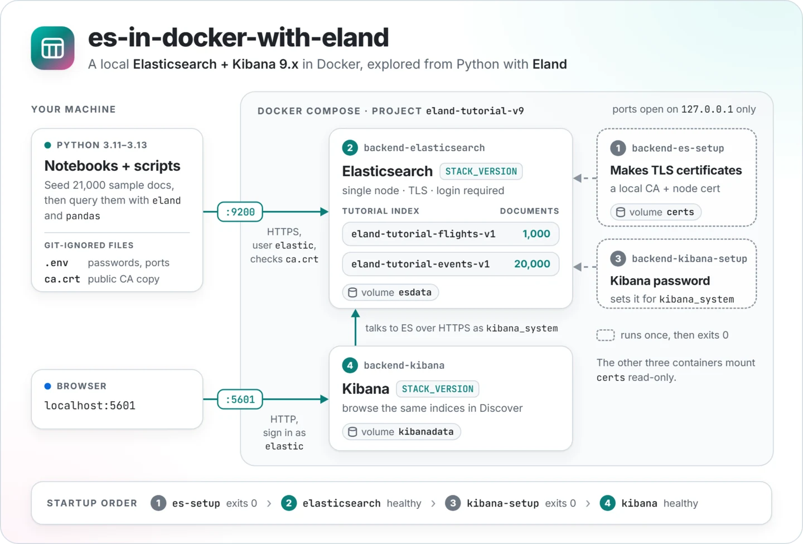
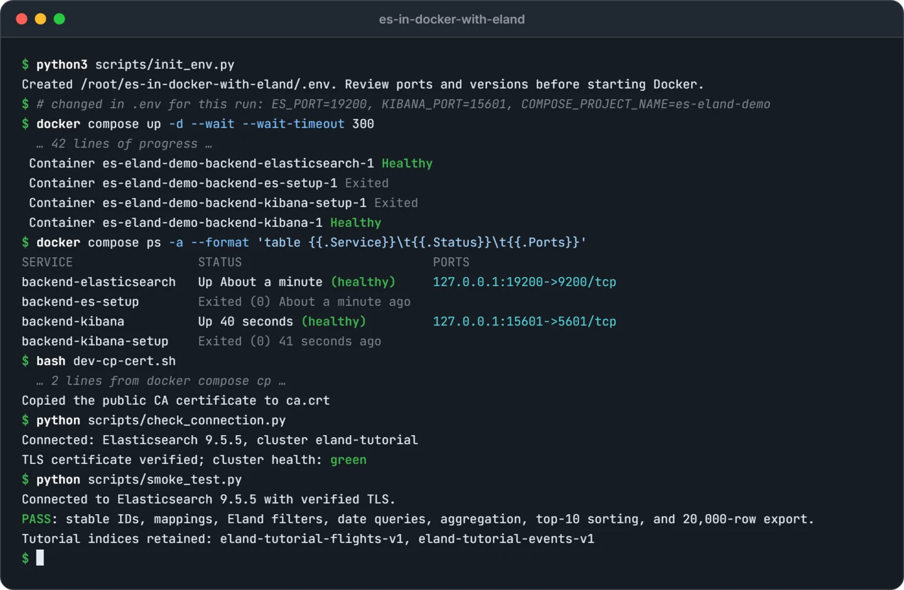
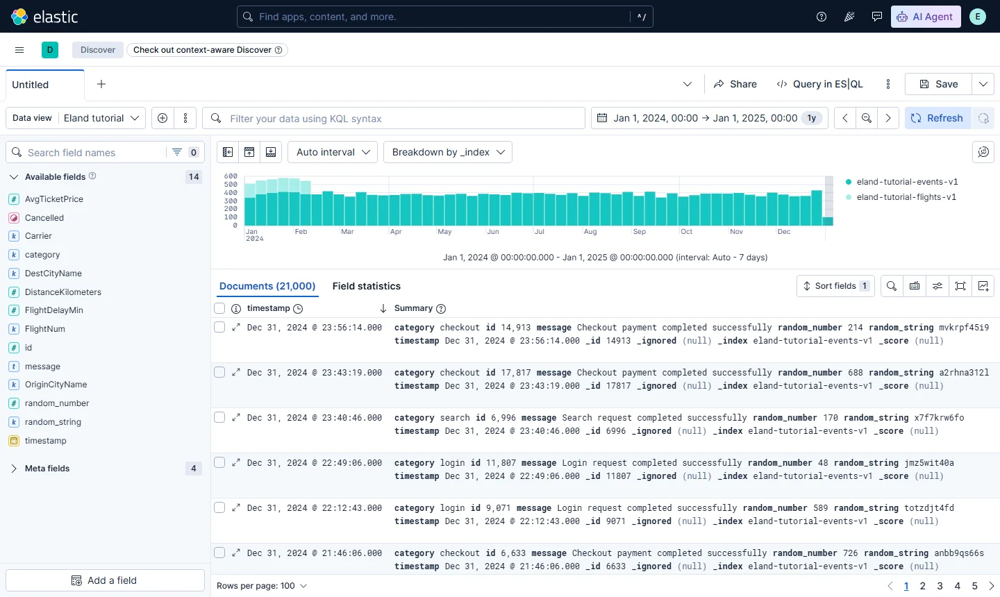
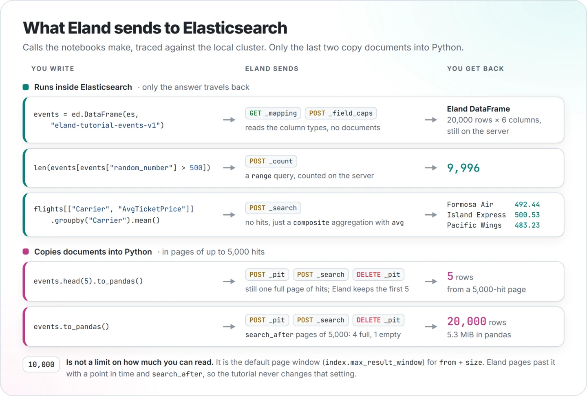

<p align="center">
  <picture>
    <source media="(prefers-color-scheme: dark)" srcset="docs/images/architecture-dark.webp">
    
  </picture>
</p>

<p align="center">
  <a href="https://github.com/NatLee/es-in-docker-with-eland/actions/workflows/ci.yml"></a>
  <a href=".env.example"></a>
  <a href="requirements.txt"></a>
  
</p>

<p align="center"><a href="README.md">English</a> · <a href="README.zh-TW.md">繁體中文</a></p>

# Elasticsearch in Docker with Eland

A local, hands-on tutorial for querying Elasticsearch from Python. One Docker Compose command starts
Elasticsearch (the search and analytics database) and Kibana (its web UI). Two Jupyter notebooks then
show how [Eland](https://github.com/elastic/eland) lets you treat an index like a pandas DataFrame while
the filtering and aggregating happen inside Elasticsearch, and when it's worth pulling rows into pandas.
The sample data is generated on the spot with a fixed seed, so nothing is downloaded and every run gives
the same numbers.

The setup is meant for your own machine, but it doesn't cut corners: Elasticsearch requires a login and
HTTPS, Python verifies the generated CA certificate, and both ports listen on `127.0.0.1` only. Kibana
itself is served over plain HTTP, which is fine for localhost and not meant for anything else.

## Before you start

| You need | Version |
| --- | --- |
| Docker | Docker Engine or Docker Desktop with the `docker compose` plugin (it must support `up --wait`) |
| Memory | At least 4 GB for Docker, plus some room for Jupyter |
| Python | 3.11–3.13; 3.12 is what CI runs the full tutorial on |
| Elasticsearch and Kibana | 9.x, one exact version for both: `STACK_VERSION` in [.env.example](.env.example) (the badge above shows it) |
| Eland and the Python client | Pinned in [requirements.txt](requirements.txt) |

On Linux, check `sysctl vm.max_map_count`. If it is below `1048576`, run
`sudo sysctl -w vm.max_map_count=1048576` and make it persistent for your distribution. On Docker
Desktop or WSL the setting lives in Docker's Linux VM; follow Elastic's
[platform-specific instructions](https://www.elastic.co/docs/deploy-manage/deploy/self-managed/install-elasticsearch-docker-prod#set-vm-max-map-count)
and don't run Linux kernel commands on a macOS host.

Run the commands below from the repository root in bash or zsh. On Windows, WSL is the smoothest
option; Git Bash with Docker Desktop also runs the Docker steps. **Coming from the old 8.x version of
this tutorial, or already have an `.env`?** Read the [migration guide](docs/UPGRADING.md) first.

## Quick start

1. **Create your local configuration.**

   ```bash
   python3 scripts/init_env.py
   ```

   This copies [.env.example](.env.example) to a private, Git-ignored `.env` and fills in random
   passwords and stable Kibana encryption keys. It refuses to overwrite an existing file. Open `.env`
   and check the ports: if `9200` or `5601` is taken, change `ES_PORT` / `KIBANA_PORT`.
   `ELASTIC_PASSWORD` is your `elastic` login; `KIBANA_PASSWORD` belongs to the internal `kibana_system`
   account.

2. **Start Elasticsearch and Kibana.**

   ```bash
   docker compose config --quiet
   docker compose up -d --wait --wait-timeout 300
   docker compose ps -a
   ```

   The first run downloads the images, which can take a few minutes. The four containers start in the
   order shown in the diagram above, and `--wait` returns once Elasticsearch and Kibana are healthy.
   The two setup containers are supposed to show `Exited (0)`. Data and certificates live in named
   Docker volumes, so there are no folders to create or permissions to fix.

3. **Copy the public CA certificate out of the container.**

   ```bash
   bash dev-cp-cert.sh
   ```

   This writes `ca.crt` to the repository root (no private keys). Run it again whenever you switch
   clusters or regenerate certificates.

4. **Create a Python environment.**

   ```bash
   python3 -m venv .venv
   source .venv/bin/activate
   python -m pip install --upgrade pip
   python -m pip install -r requirements.txt
   python -m pip check
   ```

   Make sure `python3` is a supported version (use `python3.12` if it isn't). A Conda environment with
   Python 3.12 works too, with the same pip commands.

5. **Check the connection and run the smoke test.**

   ```bash
   python scripts/check_connection.py
   python scripts/smoke_test.py
   ```

   The connection check only reads; it fails on red cluster health (yellow is normal on a single node).
   The smoke test creates the two tutorial indices, checks mappings, filters, aggregations and reading
   past 10,000 rows, and leaves the data in place for you to explore. Rerunning it rewrites the same
   document IDs instead of adding duplicates. A good run looks like this:

   <p align="center">
     
   </p>

6. **Open the notebooks.**

   ```bash
   python -m jupyterlab
   ```

   Pick the kernel from the environment you just created and run each notebook top to bottom.

## Look at the data in Kibana

Open [http://localhost:5601](http://localhost:5601) (or your `KIBANA_PORT`) and sign in as `elastic`
with the `ELASTIC_PASSWORD` from `.env`. `kibana_system` is an internal account and can't log in to
the UI. To browse both tutorial indices, create a data view. Click through **Discover → Data view →
Create a data view** with the index pattern `eland-tutorial-*` and the timestamp field `timestamp`,
or create it with one request (curl asks for the password, so it stays out of your shell history):

```bash
curl -u elastic -H 'kbn-xsrf: true' -H 'Content-Type: application/json' \
  -X POST http://localhost:5601/api/data_views/data_view \
  -d '{"data_view":{"id":"eland-tutorial","name":"Eland tutorial","title":"eland-tutorial-*","timeFieldName":"timestamp"}}'
```

The sample data is dated 2024, so set the time picker to that year, or open
[Discover with the range already set](http://localhost:5601/app/discover#/?_g=(time:(from:'2024-01-01T00:00:00.000Z',to:'2025-01-01T00:00:00.000Z'))&_a=(dataSource:(dataViewId:eland-tutorial,type:dataView),breakdownField:_index)).
You should see 21,000 documents: the flights fill January and early February, the events cover the
whole year.

<p align="center">
  <picture>
    <source media="(prefers-color-scheme: dark)" srcset="docs/images/kibana-discover-dark.webp">
    
  </picture>
</p>

The Elasticsearch API itself is at `https://localhost:9200`. Its certificate comes from the private CA
in `ca.crt`, so use the Python connection check rather than a browser to poke at it.

## How Eland talks to Elasticsearch

An Eland DataFrame is a recipe, not a copy. Creating one reads the index's columns, filters and
`len()` become a `_count` request, and group-bys become aggregations, so only the answer travels back.
Rows reach your Python process only when you call `to_pandas()` (or `ed.eland_to_pandas(...)`). Here is
what the notebooks' calls actually send:

<p align="center">
  <picture>
    <source media="(prefers-color-scheme: dark)" srcset="docs/images/eland-requests-dark.webp">
    
  </picture>
</p>

| Tool | Where the data is | Use it for |
| --- | --- | --- |
| Elasticsearch Python client | Elasticsearch | Index management, explicit Query DSL, sorting and the full API |
| Eland DataFrame | Elasticsearch; supported operations run on the server | Familiar DataFrame filters and aggregations without downloading every document first |
| pandas DataFrame | Your Python process | Local transformations and plots on a bounded result |

A few things worth knowing:

- Eland implements part of the pandas API, not all of it. See the
  [Eland DataFrame reference](https://eland.readthedocs.io/en/latest/reference/dataframe.html).
- `head(5).to_pandas()` leaves 5 rows in pandas, but Eland 9.2 still fetches one full page of up to
  5,000 hits and trims it on the client. Select columns first: in the events index that page shrinks
  from about 2.4 MB to 0.9 MB with two columns.
- **10,000 is a default search window, not an index limit.** `index.max_result_window` caps `from` +
  `size` for plain searches. Counts and aggregations cover every document, and `to_pandas()` pages past
  10,000 with a point in time and `search_after`, so the tutorial never raises that setting.
  `track_total_hits=True` makes the total count exact; it doesn't return more hits. For your own deep
  pagination, follow [Elastic's pagination guide](https://www.elastic.co/docs/reference/elasticsearch/rest-apis/paginate-search-results).

## The notebooks

| Notebook | Data and concepts |
| --- | --- |
| [eland-test.ipynb](notebooks/eland-test.ipynb) | 1,000 fictional flights: explicit mappings, Eland filters and aggregations, a bounded pandas plot, and the same aggregation written directly for Elasticsearch |
| [eland-over-10000-test.ipynb](notebooks/eland-over-10000-test.ipynb) | 20,000 events: counts beyond 10,000, UTC time ranges, boolean and full-text queries, server-side sorting, grouped statistics, and a full pandas export |

The notebooks and the smoke test share the indices `eland-tutorial-flights-v1` and
`eland-tutorial-events-v1`. Before writing, they check the tutorial's ownership metadata and the
expected mapping, and stop if either differs. Keep these indices for sample data only: reruns overwrite
the sample document IDs, and extra documents change the expected counts.

## Configuration and everyday commands

| Setting | Purpose |
| --- | --- |
| `STACK_VERSION` | One pinned version for Elasticsearch and Kibana |
| `COMPOSE_PROJECT_NAME` | Defaults to `eland-tutorial-v9`; determines the named volumes |
| `ES_PORT`, `KIBANA_PORT` | Host ports; defaults `9200`, `5601` |
| `ES_MEM_LIMIT`, `KIBANA_MEM_LIMIT` | Container memory limits; defaults `2g`, `1g` |
| `KIBANA_SECURITY_KEY`, `KIBANA_SAVED_OBJECTS_KEY`, `KIBANA_REPORTING_KEY` | Generated encryption keys; keep them when you reuse the environment |
| `ELASTIC_CA_CERT` | CA file for Python, default `ca.crt`, relative to the repository root |
| `ELASTICSEARCH_URL` | Optional Python endpoint override; otherwise HTTPS on localhost with `ES_PORT` |
| `ELASTIC_ENV_FILE` | Optional config file for Python, such as `.env.v9`; pair it with Compose's `--env-file` |

Exported shell variables win over `.env`, so a stale `export` can point you at the wrong settings.
Changing `ELASTIC_PASSWORD` in `.env` doesn't change the password already stored in an existing data
volume.

```bash
# Inspect startup problems.
docker compose logs --tail=100 backend-es-setup backend-elasticsearch backend-kibana-setup backend-kibana

# Pause and resume the existing environment.
docker compose stop
docker compose start

# Apply configuration changes and wait for readiness.
docker compose up -d --wait --wait-timeout 300

# Remove containers and network, keeping the named volumes.
docker compose down

# Open a shell in Elasticsearch.
bash dev-es-bash.sh
```

Keep the same project name to keep your data. `docker compose down --volumes`, or deleting the
project's volumes in Docker Desktop, removes the data and the certificates; it is not a routine restart.

## Troubleshooting

| Symptom | What to check |
| --- | --- |
| Startup timeout / unhealthy services | `docker compose ps -a` and the logs. Confirm Docker's memory and `vm.max_map_count`; the first image download can take a while. |
| `backend-es-setup` logs `set: pipefail: invalid option name` | The scripts were checked out with Windows (CRLF) line endings. Pull the latest version, which pins them to LF, then check the scripts out again: `git rm -q --cached -- '*.sh' && git checkout HEAD -- '*.sh'`. Pulling alone does not rewrite them. |
| `401` / authentication failure | Use `elastic` and the password this volume was created with. Check shell overrides and the selected env file; changing `.env` later doesn't reset an existing account. |
| Missing CA / certificate verification failure | Run `bash dev-cp-cert.sh` for the same project, check `ELASTIC_CA_CERT`, and use `localhost` or `127.0.0.1`. Keep certificate verification on. |
| Kibana URL fails | Use `http://localhost:5601` (or your `KIBANA_PORT`) and confirm that Kibana setup exited with code 0. |
| Port already allocated | Stop whatever uses it, or change `ES_PORT` / `KIBANA_PORT` and use the new URLs. |
| Read-only index / disk watermarks | Free space in Docker's disk allocation and check the logs; keep disk protection on. |
| ARM JVM crashes with an SVE-related illegal instruction | Update Docker and read the JVM crash log. Only for this specific issue, set `ES_JAVA_OPTS=-XX:UseSVE=0` and recreate the services. |
| Notebook import errors / old packages | Select the `.venv` kernel, restart it after package changes, and run `python -m pip check`. |
| Incompatible tutorial index mapping | Start an isolated environment with a new `COMPOSE_PROJECT_NAME`; look at the existing data before deleting anything by hand. |

## Versions

Every version is written in exactly one file, and everything else reads it from there:

- **Elastic Stack**: `STACK_VERSION` in [.env.example](.env.example). Compose uses it for both images,
  CI starts exactly that version, and the badge at the top reads it. Upgrading the tutorial is a
  one-line change to that file; CI then runs the whole tutorial against the new version. Your own `.env`
  keeps the version it was created with, see [Upgrading and migration](docs/UPGRADING.md).
- **Python packages**: [requirements.txt](requirements.txt). Dependabot proposes updates every week.
- **Supported server major**: taken from the installed Elasticsearch Python client, which only talks to
  servers of its own major version. The scripts and notebooks check this for you and say which side to
  change if the two don't match.

Eland and Elasticsearch are versioned separately. For these DataFrame examples, matching major versions
is enough. Importing NLP/PyTorch models needs matching minor versions and is outside this tutorial. See
[Eland's compatibility notes](https://github.com/elastic/eland#compatibility) and Elastic's
[Docker guide](https://www.elastic.co/docs/deploy-manage/deploy/self-managed/install-elasticsearch-docker-compose).

## Validation and maintenance

Run the offline checks after changing the Python examples:

```bash
python -m pip install -r requirements-dev.txt
python -m unittest discover -s tests -v
```

With a healthy local cluster, run `python scripts/smoke_test.py` for integration coverage, then run both
notebooks from fresh kernels. Unit tests alone don't prove that Docker starts or that the connection
works.

Besides CI, the quick start has been run by hand from a fresh clone on ARM64 Docker (2026-10-23, which
also checked that data survives recreating the containers and that an interrupted certificate setup
recovers) and on Windows 11 with Docker Desktop on x86-64 (2026-11-03, and again on 2026-11-04 after a
stack upgrade).

[GitHub Actions](.github/workflows/ci.yml) runs on pushes to `main`, on every pull request, on demand
and once a month. Unit tests on Python 3.11 and 3.13 must pass, along with a syntax check of every
shell script and a check that they keep LF line endings in a Windows-style checkout. Then the Python 3.12 integration job starts
Docker, runs the smoke test twice and executes both notebooks. New commits cancel superseded runs,
actions are pinned to commit SHAs, and failure diagnostics are kept for seven days.

[Dependabot](.github/dependabot.yml) checks pip and Actions updates weekly and groups them per
ecosystem. Major pip upgrades need a separate compatibility review. Dependabot ignores NumPy `>=2.5`
because that series needs Python 3.12 or later and this tutorial still supports 3.11. Revisit this limit
when the tutorial's minimum Python version changes; even minor package updates must pass the full Python
matrix. Dependabot can't read `.env` files, so it won't propose Elastic Stack updates; see
[Upgrading and migration](docs/UPGRADING.md#maintaining-the-tutorial-baseline) for that.

The images in this README are drawn from HTML sources in [docs/images/src/](docs/images/src/); the
terminal output, the Kibana screen and the numbers in the diagrams come from a real run.

For dependency updates, migrating from 8.x and keeping existing data, see
[Upgrading and migration](docs/UPGRADING.md).
