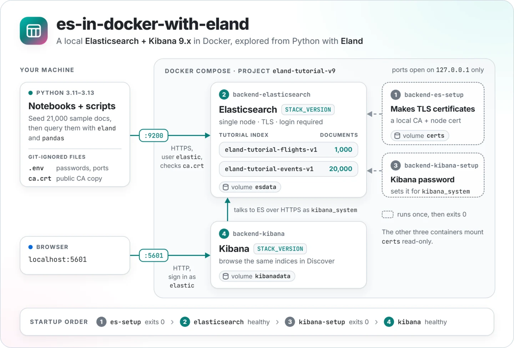
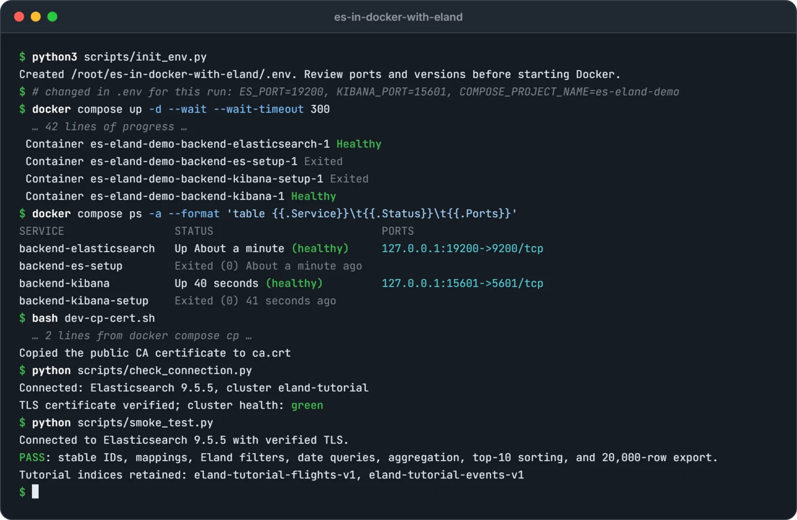
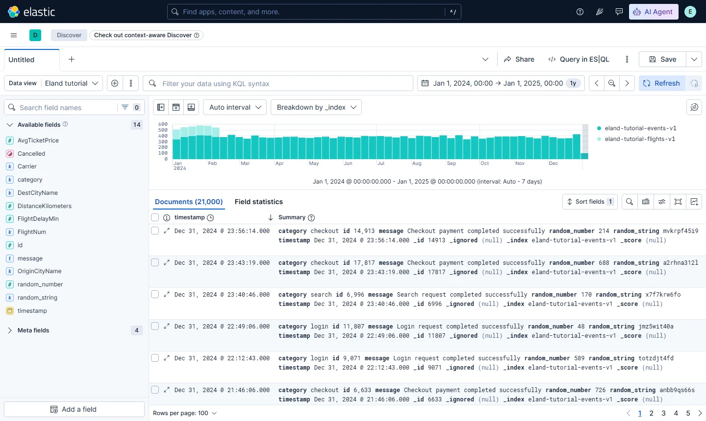
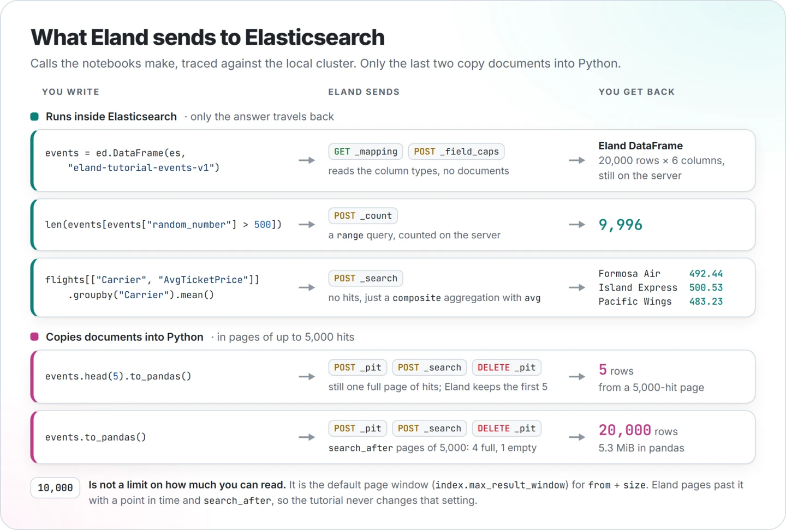

<p align="center">
  <picture>
    <source media="(prefers-color-scheme: dark)" srcset="docs/images/architecture-dark.webp">
    
  </picture>
</p>

<p align="center">
  <a href="https://github.com/NatLee/es-in-docker-with-eland/actions/workflows/ci.yml"></a>
  <a href=".env.example"></a>
  <a href="requirements.txt"></a>
  
  <a href="LICENSE"></a>
</p>

<p align="center"><a href="README.md">English</a> · <a href="README.zh-TW.md">繁體中文</a></p>

# 在 Docker 中使用 Elasticsearch 與 Eland

這是一份在自己電腦上動手做的教學：從 Python 查詢 Elasticsearch。一個 Docker Compose 指令會啟動 Elasticsearch（搜尋與分析資料庫）和 Kibana（它的網頁介面）。接著兩份 Jupyter Notebook 示範如何用 [Eland](https://github.com/elastic/eland) 把索引當成 pandas DataFrame 操作，篩選和聚合都在 Elasticsearch 裡執行，也說明什麼時候才值得把資料拉進 pandas。範例資料以固定種子當場產生，不需要下載任何資料集，每次執行的數字都一樣。

這份設定是給本機學習用的，但安全設定沒有省略：Elasticsearch 需要帳密與 HTTPS，Python 會驗證產生的 CA 憑證，兩個連接埠都只開在 `127.0.0.1`。Kibana 本身走一般 HTTP，在 localhost 上沒問題，但不適合其他用途。

## 開始之前

| 需要 | 版本 |
| --- | --- |
| Docker | Docker Engine 或 Docker Desktop，以及支援 `up --wait` 的 `docker compose` 外掛 |
| 記憶體 | 至少分配 4 GB 給 Docker，並為 Jupyter 保留一些空間 |
| Python | 3.11–3.13；CI 用 3.12 跑完整教學 |
| Elasticsearch 與 Kibana | 9.x，兩者共用一個確切版本：[.env.example](.env.example) 的 `STACK_VERSION`（上方徽章會顯示） |
| Eland 與 Python client | 版本固定在 [requirements.txt](requirements.txt) |

Linux 請先檢查 `sysctl vm.max_map_count`。若低於 `1048576`，執行 `sudo sysctl -w vm.max_map_count=1048576`，並依發行版設定為永久生效。Docker Desktop／WSL 的設定對象是 Docker 使用的 Linux 虛擬機；請參考 Elastic 的[各平台設定方式](https://www.elastic.co/docs/deploy-manage/deploy/self-managed/install-elasticsearch-docker-prod#set-vm-max-map-count)，不要在 macOS 主機上執行 Linux 核心設定指令。

以下指令請在專案根目錄用 bash 或 zsh 執行。Windows 建議使用 WSL；搭配 Docker Desktop 的 Git Bash 也能執行 Docker 相關步驟。**如果是從舊版 8.x 教學升級，或已經有 `.env`**，請先閱讀[遷移指南](docs/UPGRADING.zh-TW.md)。

## 快速開始

1. **建立本機設定。**

   ```bash
   python3 scripts/init_env.py
   ```

   程式會把 [.env.example](.env.example) 複製成限制權限、由 Git 忽略的 `.env`，並填入隨機密碼與固定的 Kibana 加密金鑰；檔案已存在時會拒絕覆寫。請打開 `.env` 檢查連接埠：如果 `9200` 或 `5601` 已被占用，就修改 `ES_PORT`／`KIBANA_PORT`。`ELASTIC_PASSWORD` 是 `elastic` 的登入密碼；`KIBANA_PASSWORD` 屬於內部的 `kibana_system` 帳號。

2. **啟動 Elasticsearch 與 Kibana。**

   ```bash
   docker compose config --quiet
   docker compose up -d --wait --wait-timeout 300
   docker compose ps -a
   ```

   第一次執行要下載映像檔，可能花幾分鐘。四個容器會依上方架構圖的順序啟動，等 Elasticsearch 和 Kibana 都健康後 `--wait` 才會結束。兩個 setup 容器顯示 `Exited (0)` 是正常的。資料與憑證存在 Docker named volumes，不需要建立資料夾或修改權限。

3. **把公開 CA 憑證複製出容器。**

   ```bash
   bash dev-cp-cert.sh
   ```

   憑證會寫到專案根目錄的 `ca.crt`（不含私鑰）。切換叢集或重新產生憑證後，請再執行一次。

4. **建立 Python 環境。**

   ```bash
   python3 -m venv .venv
   source .venv/bin/activate
   python -m pip install --upgrade pip
   python -m pip install -r requirements.txt
   python -m pip check
   ```

   請確認 `python3` 是支援的版本，必要時改用 `python3.12`。也可以建立 Python 3.12 的 Conda 環境，再執行相同的 pip 指令。

5. **檢查連線並執行 smoke test。**

   ```bash
   python scripts/check_connection.py
   python scripts/smoke_test.py
   ```

   連線檢查只讀取資訊，叢集健康狀態是 red 時會失敗（單節點出現 yellow 是正常的）。Smoke test 會建立兩個教學索引，檢查 mapping、篩選、聚合和超過 10,000 筆的讀取，並保留資料讓你觀察。重跑會覆寫相同的文件 ID，不會重複新增。成功時看起來像這樣：

   <p align="center">
     
   </p>

6. **開啟 Notebook。**

   ```bash
   python -m jupyterlab
   ```

   選用剛建立的環境作為 kernel，每份 Notebook 由上而下執行。

## 在 Kibana 看資料

開啟 [http://localhost:5601](http://localhost:5601)（或你設定的 `KIBANA_PORT`），用 `elastic` 和 `.env` 裡的 `ELASTIC_PASSWORD` 登入。`kibana_system` 是內部帳號，不能登入網頁介面。要瀏覽兩個教學索引，請先建立 data view：在 **Discover → Data view → Create a data view** 輸入 index pattern `eland-tutorial-*`、時間欄位選 `timestamp`；或用一個請求建立（curl 會詢問密碼，密碼不會留在 shell 歷史紀錄裡）：

```bash
curl -u elastic -H 'kbn-xsrf: true' -H 'Content-Type: application/json' \
  -X POST http://localhost:5601/api/data_views/data_view \
  -d '{"data_view":{"id":"eland-tutorial","name":"Eland tutorial","title":"eland-tutorial-*","timeFieldName":"timestamp"}}'
```

範例資料的日期在 2024 年，請把時間範圍設成那一年，或直接開啟[已設定好時間範圍的 Discover](http://localhost:5601/app/discover#/?_g=(time:(from:'2024-01-01T00:00:00.000Z',to:'2025-01-01T00:00:00.000Z'))&_a=(dataSource:(dataViewId:eland-tutorial,type:dataView),breakdownField:_index))。畫面上應該有 21,000 筆文件：航班集中在 1 月到 2 月初，事件分布在整年。

<p align="center">
  <picture>
    <source media="(prefers-color-scheme: dark)" srcset="docs/images/kibana-discover-dark.webp">
    
  </picture>
</p>

Elasticsearch API 在 `https://localhost:9200`。它的憑證由 `ca.crt` 這個私人 CA 簽發，所以請用 Python 連線檢查來確認，不要用瀏覽器直接開。

## Eland 怎麼跟 Elasticsearch 溝通

Eland DataFrame 是一份「查詢的做法」，不是資料的副本。建立時只讀取索引的欄位；篩選和 `len()` 會變成 `_count` 請求，分組會變成聚合，所以傳回來的只有答案。只有呼叫 `to_pandas()`（或 `ed.eland_to_pandas(...)`）時，資料列才會進到你的 Python 程序。下圖是 Notebook 裡這些呼叫實際送出的請求：

<p align="center">
  <picture>
    <source media="(prefers-color-scheme: dark)" srcset="docs/images/eland-requests-dark.webp">
    
  </picture>
</p>

| 工具 | 資料位置 | 適合用途 |
| --- | --- | --- |
| Elasticsearch Python client | Elasticsearch | 索引管理、明確的 Query DSL、排序及完整 API 操作 |
| Eland DataFrame | Elasticsearch；支援的操作由伺服器執行 | 用熟悉的 DataFrame 語法篩選與聚合，不必先下載全部文件 |
| pandas DataFrame | 本機 Python 程序 | 取回有限資料後，在本機轉換與繪圖 |

幾個值得知道的地方：

- Eland 只實作 pandas API 的一部分，詳見 [Eland DataFrame 文件](https://eland.readthedocs.io/en/latest/reference/dataframe.html)。
- `head(5).to_pandas()` 最後在 pandas 只留下 5 筆，但 Eland 9.2 仍會先取回一整頁（最多 5,000 筆）再於本機截斷。請先選好欄位：以事件索引為例，只選兩個欄位時，這一頁從約 2.4 MB 降到 0.9 MB。
- **10,000 是預設的搜尋範圍，不是索引上限。** `index.max_result_window` 限制的是一般搜尋的 `from` + `size`。計數與聚合會涵蓋全部文件；`to_pandas()` 用 point in time 和 `search_after` 讀過 10,000 筆，所以本教學從不調高這個設定。`track_total_hits=True` 只讓總筆數精確，不會多回傳文件。自己實作深度分頁時，請參考[官方分頁指南](https://www.elastic.co/docs/reference/elasticsearch/rest-apis/paginate-search-results)。

## Notebook

| Notebook | 資料與教學內容 |
| --- | --- |
| [eland-test.ipynb](notebooks/eland-test.ipynb) | 1,000 筆虛構航班：明確定義 mapping、Eland 篩選與聚合、有限資料的 pandas 繪圖，以及直接寫給 Elasticsearch 的相同聚合 |
| [eland-over-10000-test.ipynb](notebooks/eland-over-10000-test.ipynb) | 20,000 筆事件：超過 10,000 筆的計數、UTC 時間區間、布林與全文查詢、伺服器排序、分組統計及完整 pandas 匯出 |

Notebook 與 smoke test 共用 `eland-tutorial-flights-v1`、`eland-tutorial-events-v1` 兩個索引。寫入前會檢查教學專用的擁有權標記與 mapping，不符合就停止。這兩個索引請只放範例資料：重跑會覆寫相同文件 ID，額外加入的文件會改變預期筆數。

## 設定與日常操作

| 設定 | 用途 |
| --- | --- |
| `STACK_VERSION` | 統一固定 Elasticsearch 與 Kibana 版本 |
| `COMPOSE_PROJECT_NAME` | 預設 `eland-tutorial-v9`，決定使用的 named volumes |
| `ES_PORT`、`KIBANA_PORT` | 主機連接埠，預設 `9200`、`5601` |
| `ES_MEM_LIMIT`、`KIBANA_MEM_LIMIT` | 容器記憶體上限，預設 `2g`、`1g` |
| `KIBANA_SECURITY_KEY`、`KIBANA_SAVED_OBJECTS_KEY`、`KIBANA_REPORTING_KEY` | 自動產生的加密金鑰；繼續使用同一環境時請保留 |
| `ELASTIC_CA_CERT` | Python 使用的 CA，預設 `ca.crt`；相對於專案根目錄 |
| `ELASTICSEARCH_URL` | 可選的 Python 端點；未設定時使用 localhost、HTTPS 與 `ES_PORT` |
| `ELASTIC_ENV_FILE` | 可選的 Python 設定檔，如 `.env.v9`；搭配 Compose 的 `--env-file` |

Shell 中已匯出的環境變數優先於 `.env`，殘留的 `export` 可能讓你連到錯的設定。修改 `.env` 裡的 `ELASTIC_PASSWORD`，不會改變既有資料卷中已儲存的密碼。

```bash
# 查看啟動問題。
docker compose logs --tail=100

# 暫停及恢復既有環境。
docker compose stop
docker compose start

# 套用設定變更並等待服務就緒。
docker compose up -d --wait --wait-timeout 300

# 移除容器與網路，保留 named volumes。
docker compose down

# 進入 Elasticsearch 容器。
bash dev-es-bash.sh
```

保留相同專案名稱才能繼續使用原本資料。`docker compose down --volumes`，或在 Docker Desktop 刪除專案資料卷，會移除資料與憑證；日常重啟不需要這些操作。

## 常見問題

| 問題 | 檢查方式 |
| --- | --- |
| 啟動逾時／服務 unhealthy | 查看 `docker compose ps -a` 與日誌，確認 Docker 記憶體和 `vm.max_map_count`；首次下載映像檔可能較久。 |
| `backend-es-setup` 日誌出現 `set: pipefail: invalid option name` | 腳本被以 Windows 換行（CRLF）取出。請先更新到最新版（已固定為 LF），再重新取出腳本：`git rm -q --cached -- '*.sh' && git checkout HEAD -- '*.sh'`。只更新不會改寫已經取出的檔案。 |
| `401`／帳密驗證失敗 | 使用 `elastic` 與這個資料卷建立時的密碼，檢查 shell 覆寫值及所選設定檔；事後修改 `.env` 不會重設既有帳號。 |
| 找不到 CA／憑證驗證失敗 | 對同一專案執行 `bash dev-cp-cert.sh`，確認 `ELASTIC_CA_CERT`，使用 `localhost` 或 `127.0.0.1`，並保持憑證驗證開啟。 |
| Kibana 無法開啟 | 使用 `http://localhost:5601`（或你的 `KIBANA_PORT`），確認 Kibana setup 以代碼 0 結束。 |
| 連接埠被占用 | 停止占用的服務，或修改 `ES_PORT`／`KIBANA_PORT` 並使用新網址。 |
| 索引唯讀／disk watermark | 釋放 Docker 磁碟空間並檢查日誌，保留磁碟保護設定。 |
| ARM JVM 出現 SVE 相關 illegal instruction | 更新 Docker 並查看 JVM crash log；僅在確認是此原因時，設定 `ES_JAVA_OPTS=-XX:UseSVE=0` 後重建服務。 |
| Notebook 匯入失敗／套件仍是舊版 | 選用 `.venv` kernel，更新套件後重啟 kernel，並執行 `python -m pip check`。 |
| 教學索引 mapping 不相容 | 用新的 `COMPOSE_PROJECT_NAME` 建立獨立環境；手動刪除前先確認既有資料的用途。 |

## 版本說明

每個版本號都只寫在一個檔案，其他地方都從那裡讀：

- **Elastic Stack**：[.env.example](.env.example) 的 `STACK_VERSION`。Compose 用它決定兩個映像檔的版本，CI 啟動的就是這個版本，最上方的徽章也是讀它。升級教學只要改這一行，CI 會用新版本把整套教學跑一遍。你自己的 `.env` 會保留建立時的版本，請見[升級與遷移指南](docs/UPGRADING.zh-TW.md)。
- **Python 套件**：[requirements.txt](requirements.txt)，Dependabot 每週提出更新。
- **支援的伺服器主版本**：由已安裝的 Elasticsearch Python client 決定，因為 client 只能連同一個主版本的伺服器。腳本和 Notebook 會自動檢查，不相符時會說明該改哪一邊。

Eland 與 Elasticsearch 各自發布版本。這些 DataFrame 範例只需主版本相同；匯入 NLP／PyTorch 模型則要求次版本一致，不在本教學範圍。詳見 [Eland 相容性說明](https://github.com/elastic/eland#compatibility)與 Elastic 的 [Docker 文件](https://www.elastic.co/docs/deploy-manage/deploy/self-managed/install-elasticsearch-docker-compose)。

## 驗證與維護

修改 Python 範例後，可執行不需連線叢集的檢查：

```bash
python -m pip install -r requirements-dev.txt
python -m unittest discover -s tests -v
```

本機叢集健康時，再執行 `python scripts/smoke_test.py` 驗證整合，並以重新啟動的 kernel 執行兩份 Notebook。單元測試本身無法證明 Docker 能啟動或連線正常。

除了 CI，快速開始也實際從全新 clone 手動跑過：ARM64 Docker（2026-10-23，並確認重建容器後資料仍在、憑證初始化中斷後能恢復），以及 x86-64 的 Windows 11 加 Docker Desktop（2026-11-03，2026-11-04 升級 Elastic Stack 後又跑一次）。

[GitHub Actions](.github/workflows/ci.yml) 會在 push 到 `main`、所有 pull request、手動執行及每月排程時檢查。Python 3.11／3.13 單元測試、所有 shell 腳本的語法檢查，以及「在 Windows 式取出時 shell 腳本仍是 LF 換行」的檢查都通過後，才以 Python 3.12 啟動 Docker、重跑兩次 smoke test 並執行兩份 Notebook。新提交會取消同一分支或 PR 過時的執行；Actions 固定於 commit SHA，整合測試失敗的診斷檔保留七天。

[Dependabot](.github/dependabot.yml) 每週檢查 pip 與 Actions 更新，並按套件來源分組；pip 套件主版本升級需另外檢查相容性。Dependabot 排除 NumPy `>=2.5`，因為該系列要求 Python 3.12 以上，而本教學仍支援 3.11。調整教學的最低 Python 版本時，請一併檢視此限制；即使只是套件次版本更新，也必須通過完整 Python 測試矩陣。Dependabot 讀不懂 `.env` 檔，不會提出 Elastic Stack 的更新，做法請見[升級與遷移指南](docs/UPGRADING.zh-TW.md#持續維護教學版本)。

README 裡的圖片由 [docs/images/src/](docs/images/src/) 的 HTML 原始檔產生；終端機輸出、Kibana 畫面和圖中的數字都來自實際執行。

後續套件更新、從 8.x 遷移與保留既有資料的方法，請閱讀[升級與遷移指南](docs/UPGRADING.zh-TW.md)。

## 授權

以 [MIT 授權](LICENSE)釋出。
